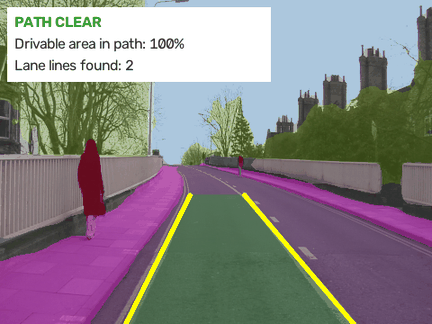
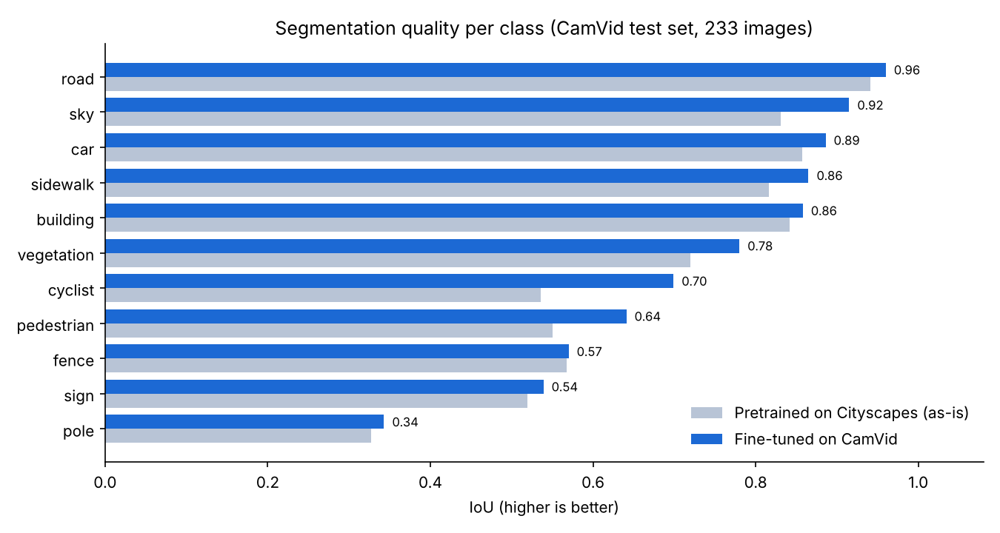
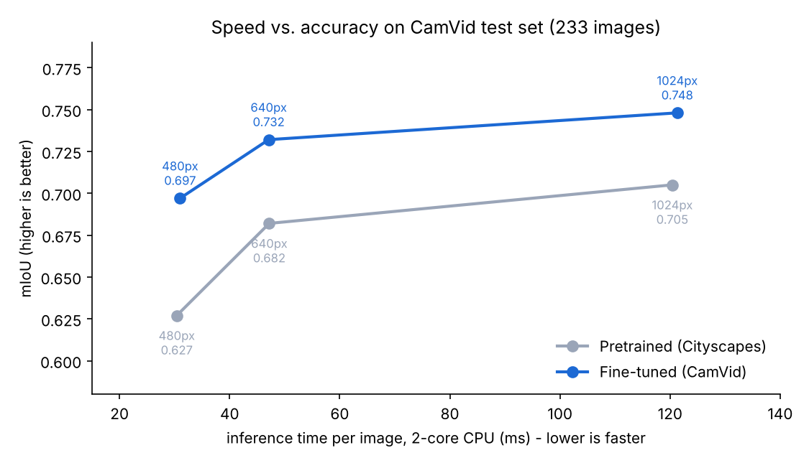
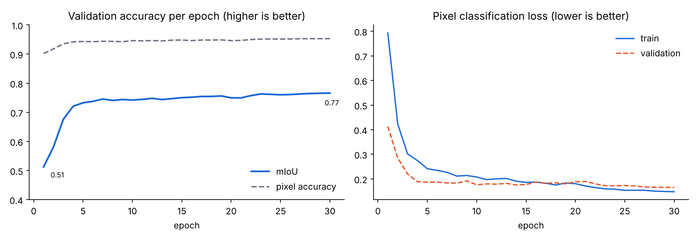
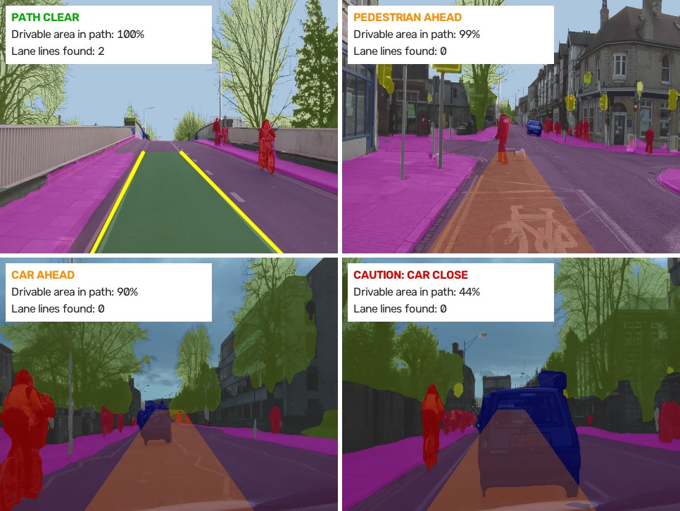
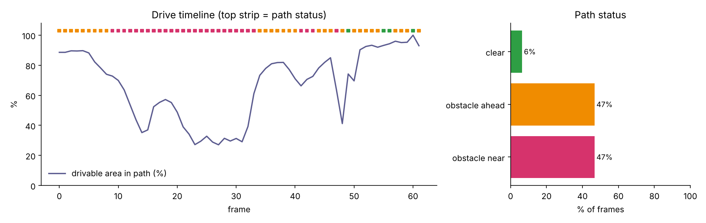

# Road, Lane and Obstacle Segmentation

This project labels every pixel of a dashcam frame (road, sidewalk, car, pedestrian, cyclist and so on), finds the lane lines, and checks whether the path in front of the car is clear. Those are roughly the building blocks behind lane keeping, free-space detection and collision warnings.

I used a YOLO26 semantic segmentation model that Ultralytics pretrained on Cityscapes (German city streets) and fine-tuned it on CamVid (Cambridge, UK). The lane lines are found with plain OpenCV, and every frame is logged to a CSV file.


<sub>CamVid test drives the model never saw. Green corridor: path clear, orange: obstacle in the path, yellow: detected lane lines.</sub>

## Results

Scored on the 233 CamVid test images. The metric is IoU, the overlap between predicted and true pixels (1.0 would be perfect). mIoU is the average over all 11 classes.

| Metric (640 px) | Pretrained on Cityscapes, used as-is | Fine-tuned on CamVid |
|---|---|---|
| mIoU | 0.682 | **0.732** |
| Pixel accuracy | 0.905 | **0.929** |
| Inference time | 47 ms per image | 47 ms per image (2-core CPU, no GPU) |



| Class | Pretrained | Fine-tuned | | Class | Pretrained | Fine-tuned |
|---|---|---|---|---|---|---|
| road | 0.941 | 0.960 | | vegetation | 0.720 | 0.780 |
| sky | 0.831 | 0.915 | | cyclist | 0.536 | 0.699 |
| car | 0.857 | 0.886 | | pedestrian | 0.550 | 0.641 |
| sidewalk | 0.816 | 0.865 | | fence | 0.568 | 0.570 |
| building | 0.842 | 0.858 | | sign | 0.519 | 0.539 |
| | | | | pole | 0.327 | 0.343 |

I also tried three image sizes (mIoU and time per image):

| Model | 480 px | 640 px | 1024 px |
|---|---|---|---|
| Pretrained (Cityscapes) | 0.627, 30 ms | 0.682, 47 ms | 0.705, 120 ms |
| Fine-tuned (CamVid) | 0.697, 31 ms | **0.732, 47 ms** | 0.748, 121 ms |



<sub>YOLO26n-sem (1.6 M parameters, 3.4 MB), 30 epochs on 367 images at 480 px, CPU only, about 1.5 hours. Full numbers in [`results/`](results/).</sub>

### What I noticed

The pretrained model already did surprisingly well on English streets it had never seen (0.68 mIoU). Fine-tuning on 367 local images added 5 points overall, and the biggest jumps were for cyclists (0.54 to 0.70) and pedestrians (0.55 to 0.64), which are also the classes I care most about. Part of that is just different label definitions: in CamVid a cyclist includes the bike, for example.

640 px turned out to be the best trade-off. The fine-tuned model at 640 px is better than the pretrained one at 1024 px (0.732 vs 0.705) and 2.5 times faster. Going up to 1024 px only adds 0.016 mIoU for 2.6 times the compute, which doesn't seem worth it on fixed in-car hardware.

Thin things like poles (0.34) and signs (0.54) are the hardest. They cover about 1% of the pixels and are only a few pixels wide, so small errors at the edges cost a lot of IoU. Higher resolution helps them the most (poles go from 0.34 to 0.39 at 1024 px).

Most of the gain came very early: validation mIoU went from 0.51 to 0.73 in the first 5 epochs and then crept up to 0.77 by epoch 30.



### Lanes and obstacles


<sub>Both lane lines found, pedestrian crossing in the path, car ahead, car close (caution).</sub>

On the 171-frame Seq05VD test drive, lane lines were found in 80% of frames.

I found one bug while looking through the output. At junctions, painted symbols like a cycle-lane bicycle produced a left and a right line that crossed each other. That turned the driving corridor into an X and pedestrians on the pavement got flagged as "in path". I added a check that rejects crossing or very narrow lane pairs and falls back to a fixed zone in front of the car. False obstacle warnings on that drive went from 7 frames to 2, and both remaining ones were real (a pedestrian crossing and a car turning in).

On the 0001TP drive (62 frames) the car follows another car. As the gap closed, the free distance in the corridor dropped from 65% to under 1% and the status went from "car ahead" to "caution", then back again when the gap opened.



## How it works

```
 camera frame
     │
     ▼
 YOLO26-sem (pretrained on Cityscapes, fine-tuned on CamVid)
     │  class for every pixel: road, sidewalk, car, pedestrian, cyclist, ...
     ├──────────────► coloured overlay
     ▼
 OpenCV lane detection inside the predicted road
     │  bright / yellow pixels -> Canny edges -> Hough lines -> left + right lane fit -> sanity check
     ▼
 Driving corridor (ego lane, or a fixed zone ahead if no lanes are found)
     │  cars / pedestrians / cyclists inside it? how close?
     ▼
 PATH CLEAR / OBSTACLE AHEAD / CAUTION      +  frame_metrics.csv
```

I went with segmentation instead of bounding boxes because boxes can't tell you where the road actually ends. Starting from Cityscapes made sense because it's recorded with a car-mounted camera in 50 German cities, so very little data was needed to adapt it. CamVid has no lane-marking labels, so I used classic image processing inside the predicted road for the lanes. It's cheap and easy to debug, which helped with the bug above.

## Project structure

```
road-scene-segmentation/
├── configs/camvid.yaml           # dataset definition (11 classes)
├── src/
│   ├── prepare_data.py           # download CamVid from GitHub and convert it
│   ├── train.py                  # fine-tune YOLO26-sem on CamVid
│   ├── evaluate.py               # per-class IoU vs. the pretrained baseline -> CSV, chart, markdown
│   ├── segment.py                # image / folder / video / webcam -> overlay + lanes + obstacle check + CSV
│   └── drive_report.py           # drive summary chart from frame_metrics.csv
├── notebooks/train_on_colab.ipynb  # retrain on a free Colab GPU
├── weights/best.pt               # trained model (3.4 MB)
├── results/                      # metrics, training log, speed/accuracy table, sample drive
└── assets/                       # images and demo animation for this README
```

## Running it

```bash
pip install -r requirements.txt

python src/segment.py --source path/to/dashcam.mp4       # road, lanes and obstacles
python src/drive_report.py                               # summary of that run

python src/prepare_data.py                               # download CamVid (~170 MB)
python src/evaluate.py                                   # reproduce the results above
python src/train.py --epochs 60 --device 0               # retrain (GPU recommended)
```

Or open `notebooks/train_on_colab.ipynb` in Google Colab to retrain on a free GPU.

## Limitations and what I'd do next

- "Free distance" is measured in the image (share of the corridor below the nearest obstacle), not in metres. Real distances would need camera calibration.
- The lane detection is rule-based and I only checked it visually, not against lane ground truth. A learned lane model (e.g. trained on CULane or TuSimple) would deal better with worn markings, curves and night driving.
- Each frame is processed on its own. Smoothing over consecutive frames would get rid of the flicker.
- CamVid is daytime driving in Cambridge. I'd like to test it on German roads, at night and in the rain.

## Tech stack

Python, Ultralytics YOLO26, PyTorch, OpenCV, NumPy, pandas, matplotlib, Google Colab

## Credits and licences

- Model and training framework: [Ultralytics](https://github.com/ultralytics/ultralytics) (AGPL-3.0). The starting weights were pretrained by Ultralytics on [Cityscapes](https://www.cityscapes-dataset.com/) (non-commercial licence)
- Dataset and demo images: [CamVid](http://mi.eng.cam.ac.uk/research/projects/VideoRec/CamVid/), University of Cambridge (Brostow, Fauqueur and Cipolla, 2009), via the [SegNet tutorial](https://github.com/alexgkendall/SegNet-Tutorial) repository
- Project idea from [project-based-learning](https://github.com/practical-tutorials/project-based-learning)

Released under AGPL-3.0 to match Ultralytics.

Souad Essemyhij, MSc Robotics and Autonomous Systems, Universität zu Lübeck. [LinkedIn](https://www.linkedin.com/in/souad-essemyhi-742a9520b/)
